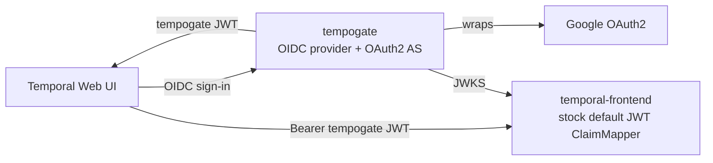

# tempogate

[](https://github.com/onhotpath/tempogate/actions/workflows/ci.yml)
[](LICENSE)
[](https://pkg.go.dev/github.com/onhotpath/tempogate)
[](https://codecov.io/gh/onhotpath/tempogate)

**Single sign-on and per-namespace access control for self-hosted [Temporal](https://temporal.io/).
No fork of `temporal-server`. No proxy in front of it.**

tempogate is a single-binary OIDC provider and OAuth2 authorization server.
Your people sign in with Google.
tempogate gives them short-lived JWTs that the stock Temporal authorizer already accepts.
Your services get scoped, expiring keys.
You keep the Temporal release that you use now.

<p align="center">
  
</p>

## Why tempogate?

Self-hosted Temporal has two extension points for authentication:

- The **Web UI** accepts any OIDC issuer through its `TEMPORAL_AUTH_*` environment variables.
- The **gRPC frontend** verifies JWTs against a JWKS URL and reads a `permissions: ["<namespace>:<role>", ...]` claim.

Together, these give SSO and machine authentication.
But Temporal does not include the issuer that makes the tokens.
Without one, the usual choices are a fork of `temporal-server` or a proxy in front of it.
Both have a cost that continues.

tempogate is the issuer.
You point Temporal at it with two settings, and you change no Temporal code.

| Approach | Pros | Cons |
| --- | --- | --- |
| **tempogate** | Works with stock Temporal. No fork, no proxy. | One more component to operate. |
| Reverse proxy in front of the UI and gRPC | Authentication logic stays outside Temporal. | Must split gRPC and HTTP; fragile with streams; hides Temporal's own auth machinery. |
| Fork of `temporal-server` | Full control. | A rebase on every upstream release; no upstream support. |

## Features

**For your people**

- **Browser SSO for the Temporal Web UI.** People sign in with Google. [Workspace mode](docs/configuration.md#hosted-domain-workspace-mode) blocks consumer Google accounts.
- **Tokens for the terminal.** Run `tempogate login` once. Then `tempogate token` prints a fresh JWT for the Temporal CLI and SDKs, and refreshes it before it expires.
- **Sign-in with no browser.** `tempogate login --device` works on SSH hosts, cloud VMs and CI shells ([RFC 8628](https://datatracker.ietf.org/doc/html/rfc8628)).

**For your services**

- **Integration keys.** An authenticated admin API mints a JWT for one namespace and one role. Each key must have an expiry date, and every mint and revoke goes to an audit log.

**For your security team**

- **Deny by default.** Rules map an email or a domain to Temporal namespaces and roles. A person that no rule matches gets no token.
- **Sessions that you can revoke.** Refresh tokens rotate on each use. A reused token ends the session. One command ends all sessions of a user.
- **Defense in depth.** Mandatory PKCE, exact redirect URIs, rate limits, secrets hashed at rest, optional encryption of the signing key, and signed images with SLSA provenance and an SBOM.

**For your operators**

- **One binary.** One distroless image is the server and the CLI. Subcommands do migrations, key rotation, session revocation and rule checks.
- **SQLite or PostgreSQL.** SQLite for one replica. PostgreSQL 15+ for several replicas.
- **Ready for Kubernetes.** A Helm chart, `/healthz` and `/readyz` probes, Prometheus metrics and one structured log line per request.
- **Key rotation with no restart.** Generate, publish and retire signing keys while the server runs.
- **Tested against real Temporal.** End-to-end tests run the Web UI, a JWKS-backed `temporal-frontend` and headless Chrome for every login flow.

## How it works



1. The Web UI sends the browser to tempogate, and tempogate sends it to Google.
2. tempogate checks the Google account against your allowed domains and your rules.
3. tempogate returns a signed access token with a `permissions` claim, and a separate ID token for the UI login.
4. The Temporal frontend verifies the access token against the tempogate JWKS. The stock ClaimMapper reads the permissions.

In Temporal, set two values:

- Web UI: `TEMPORAL_AUTH_PROVIDER_URL=https://tempogate.example.com`, with the other `TEMPORAL_AUTH_*` variables.
- Frontend: `global.authorization.jwtKeyProvider.keySourceURIs` to `https://tempogate.example.com/.well-known/jwks.json`.

[examples/kind/temporal-values.yaml](examples/kind/temporal-values.yaml) shows both, for the Temporal Helm chart and for Docker.
[docs/architecture.md](docs/architecture.md) explains the design decisions.

## Quick start

See the full stack work in less than ten minutes.
You need only Docker. A mock identity provider replaces Google, so you need no Google account.

```bash
echo "127.0.0.1 tempogate temporal-ui mockoidc" | sudo tee -a /etc/hosts
git clone https://github.com/onhotpath/tempogate.git
cd tempogate/examples/docker-compose
./gen-env.sh > .env
docker compose up --build
```

Then open <http://temporal-ui:8080> and sign in.

> [!CAUTION]
> This stack is for development only. Its mock identity provider signs in anyone as any identity.
> Do not expose it to a network.

[docs/getting-started.md](docs/getting-started.md) walks you through the stack, the CLI token and the integration keys.

## Install

| Target | How |
| --- | --- |
| Container image | `docker pull ghcr.io/onhotpath/tempogate:latest` (`linux/amd64`, `linux/arm64`) |
| Kubernetes | `helm install tempogate oci://ghcr.io/onhotpath/charts/tempogate` |
| CLI on macOS | `brew tap onhotpath/tempogate https://github.com/onhotpath/tempogate`<br>`brew trust --cask onhotpath/tempogate/tempogate`<br>`brew install --cask tempogate` |
| CLI on Linux or macOS | Download from [GitHub Releases](https://github.com/onhotpath/tempogate/releases) |
| From source | `make build` (Go 1.27+) |

The macOS binary is not notarized by Apple, and the cask removes the quarantine attribute.
Read [the macOS note](docs/installation.md#macos-homebrew) before you install it.

> [!IMPORTANT]
> Upgrading from v0.2.0? v0.3.0 has breaking changes. Follow [docs/upgrading.md](docs/upgrading.md).

[docs/installation.md](docs/installation.md) gives the full steps: a `docker run` example, image tags, signature checks and a build from source.
For a real Google sign-in, first [create the Google OAuth client](examples/google-oauth-setup.md).

## Usage

### Give people access

Sign-in only admits a person.
Authorization rules decide what the access token of that person can do in Temporal.
The default is deny.

```bash
OIDC_AUTHZ_RULES_0='email:alice@example.com=temporal-system:admin'   # cluster admin
OIDC_AUTHZ_RULES_1='domain:example.com=orders:read,payments:read'    # everyone else at example.com
```

- All matching rules apply. If two rules name the same namespace, the higher role wins.
- A person that no rule matches gets `OIDC_AUTHZ_DEFAULT_PERMISSIONS`. If that is empty, the sign-in fails with `access_denied`.
- `tempogate serve` does not start if there are no rules and no default.
- Each token refresh applies the rules again. A change reaches a signed-in user within `OIDC_ACCESS_TOKEN_TTL` (default 4 hours) after a restart.
  If the rules no longer grant a person anything, the session of that person ends.
- `tempogate authz explain --email <e>` shows the matching rules and the resulting claim.

> [!IMPORTANT]
> Releases up to v0.2.0 have no rules, and give every admitted person cluster admin.
> To keep that behaviour while you write rules, set `OIDC_AUTHZ_DEFAULT_PERMISSIONS=temporal-system:admin`.
> See [the upgrade guide](docs/upgrading.md).

Read [Authorization](docs/configuration.md#authorization) for the grammar, and [Multi-tenancy](docs/architecture.md#multi-tenancy) for how Temporal enforces namespace boundaries.

### Get a token on your laptop

```bash
export TEMPOGATE_ISSUER=https://tempogate.example.com

tempogate login                                  # browser sign-in, once
export TEMPORAL_AUTH_TOKEN=$(tempogate token)    # after that; refreshes automatically
```

- `tempogate login` opens a one-time server on `127.0.0.1` and sends your browser to Google.
- The token goes to `~/.tempogate/token.json` (mode `0600`).
- `tempogate token` refreshes the token five minutes before it expires, so it does not open the browser again.
- Both commands print only the token to stdout, so you can use them in `$(...)`.
- `tempogate token` is safe to run concurrently, for example as a credential helper.
- On a host with no browser, use `tempogate login --device`.

The server needs only one `OIDC_CLIENTS` entry, and you make no changes in the Google Cloud Console.
See [docs/cli-loopback-login.md](docs/cli-loopback-login.md) and [docs/cli-device-login.md](docs/cli-device-login.md).

### Mint a key for a service

The admin API is on a separate listener (`ADMIN_LISTENER`, default `127.0.0.1:8081`).
It accepts only a bearer token whose SHA-256 is in `ADMIN_TOKEN_SHA256`.

```bash
token=$(openssl rand -base64 32 | tr '+/' '-_' | tr -d '=')
export ADMIN_TOKEN_SHA256=$(printf %s "$token" | sha256sum | cut -d' ' -f1)
# after you start tempogate serve:
curl -H "Authorization: Bearer $token" -H 'Content-Type: application/json' \
  -d '{"namespace":"payments","role":"write","owner":"svc-payments","expires_at":"2026-12-31T00:00:00Z"}' \
  http://127.0.0.1:8081/admin/keys
```

- `expires_at` is necessary, and it can be at most `ADMIN_KEYS_MAX_TTL` (default 90 days) in the future.
- A grant on `temporal-system` (all namespaces) gets 403, unless `ADMIN_ALLOW_SYSTEM_GRANTS=true`.
- A `Host` header that is not in `ADMIN_ALLOWED_HOSTS` gets 421.

See [Admin API](docs/configuration.md#admin-api).

### Revoke access

The Temporal frontend checks only the token signature and its `exp`.
It does not know about revocations in tempogate.
Each lever thus has a different effect:

| Lever | Effect at the Temporal frontend |
| --- | --- |
| `tempogate sessions revoke --email <e>` or `POST /admin/sessions/revoke` | Stops all refreshes at once. Access tokens already issued stay valid until they expire (`OIDC_ACCESS_TOKEN_TTL`, default 4 hours). |
| `DELETE /admin/keys/{id}` | None. The key works at Temporal until its `exp`. tempogate's own `/userinfo` refuses it within 30 seconds. |
| `tempogate keys retire <kid>` or `POST /admin/signing-keys/{kid}/retire` | After `KEYS_RETIREMENT_GRACE` (default 4 hours) and the next JWKS refresh of Temporal, every token that the key signed stops working. |

Retiring a signing key is the hard kill switch.
First rotate with `tempogate keys generate --force`.
The server publishes the new key without a restart, and signs with it after `KEYS_PUBLISH_DELAY` (default 5 minutes).
Follow the [rotation runbook](docs/configuration.md#rotation-runbook).
Sessions also end automatically: see [Refresh-token sessions](docs/configuration.md#refresh-token-sessions) for the idle and absolute lifetimes, and for reuse detection.

## Configuration

tempogate reads its settings in three layers, and the last layer wins:

1. Built-in defaults.
2. An optional YAML file: `--config <path>`, else `$TEMPOGATE_CONFIG`, else `application.yaml` in the working directory.
3. Environment variables. Nested keys use `_` as the separator, so `oidc.google.client_id` becomes `OIDC_GOOGLE_CLIENT_ID`.

**Minimum for real SSO:** `OIDC_ISSUER`, `OIDC_CLIENTS`, `OIDC_ALLOWED_DOMAINS`, `OIDC_SESSION_SIGNING_KEY`, `OIDC_GOOGLE_CLIENT_ID`, `OIDC_GOOGLE_CLIENT_SECRET`, and one or more `OIDC_AUTHZ_RULES_<n>` (or `OIDC_AUTHZ_DEFAULT_PERMISSIONS`).
For Google Workspace, also set `OIDC_ALLOWED_HOSTED_DOMAINS`.

The [configuration reference](docs/configuration.md#quick-reference) lists every setting with its default.
It also covers [PostgreSQL for several replicas](docs/configuration.md#postgresql), [sub-path hosting](docs/configuration.md#sub-path-hosting) on a shared hostname, and [metrics](docs/configuration.md#observability).

## Documentation

| Guide | Topic |
| --- | --- |
| [Getting started](docs/getting-started.md) | Web UI SSO and a CLI token in ten minutes, with a mock identity provider |
| [Installation](docs/installation.md) | Image, Helm chart, CLI binaries, Homebrew and build from source |
| [Upgrading](docs/upgrading.md) | What to change when you upgrade, release by release |
| [Configuration](docs/configuration.md) | Every setting, revocation, key rotation and observability |
| [Architecture](docs/architecture.md) | How the parts fit together, design decisions and multi-tenancy |
| [CLI loopback login](docs/cli-loopback-login.md) | The `tempogate login` flow, token storage and refresh |
| [CLI device login](docs/cli-device-login.md) | `tempogate login --device` for hosts with no browser |
| [PKCE and confidential clients](docs/pkce-and-confidential-clients.md) | The PKCE rules and the exception for the Temporal Web UI |
| [Google OAuth setup](examples/google-oauth-setup.md) | Create the upstream Google OAuth client |
| [Helm chart](charts/tempogate/README.md) | Kubernetes deployment and chart values |
| [docker-compose example](examples/docker-compose/README.md) | The full stack on one machine (development only) |
| [kind example](examples/kind/README.md) | The Helm chart on a local Kubernetes cluster |

## Development

```bash
make tools      # install the pinned linters and tools into ./.bin
make test       # format checks, vet, race tests and coverage
make ci         # what GitHub Actions runs
make test-e2e   # end-to-end tests against real Temporal (needs Docker)
make gen-oas    # write the OpenAPI 3.1 specs to api/openapi.yaml and api/openapi.admin.yaml
```

`make test-e2e` uses testcontainers to start `temporalio/ui`, a JWKS-backed `temporal-frontend`, a mock Google identity provider and headless Chrome.
It proves the Web UI SSO, the CLI loopback and device flows, the integration keys, the refresh-token lifecycle, the multi-tenant scope and the hardening checks.
Each login test asserts that the minted JWT authenticates a gRPC `ListNamespaces` call, and that a call without a token fails.

Go 1.27 or later is necessary.
Read [CONTRIBUTING.md](CONTRIBUTING.md) before you open a pull request.

## Security

- tempogate creates the state database with mode `0600`, in a `0700` directory when it creates the directory.
- It stores bearer secrets (refresh tokens, authorization codes, device codes and session IDs) only as SHA-256 hashes.
- It stores the signing key as plain PEM, unless you set `KEYS_ENCRYPTION_KEY`. Set it in production, so that a leaked backup cannot mint tokens. See [Signing-key encryption](docs/configuration.md#signing-key-encryption).

Report vulnerabilities through [GitHub Security Advisories](https://github.com/onhotpath/tempogate/security/advisories/new), as [SECURITY.md](SECURITY.md) describes.
**Do not** open a public issue for a security report.

## License

Apache 2.0. See [LICENSE](LICENSE).
