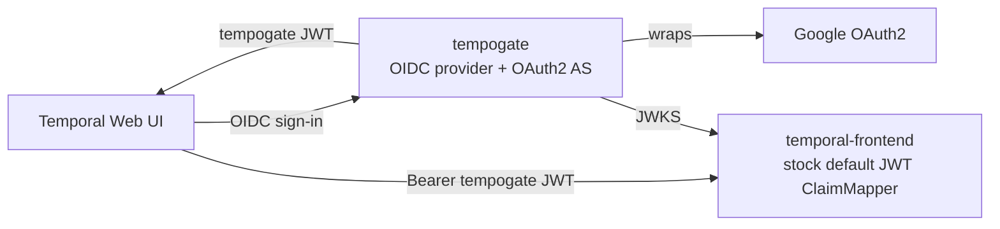

# Architecture

## The gap tempogate fills

Self-hosted Temporal has two extension points for authentication:

- the **Web UI** accepts any OIDC issuer through `TEMPORAL_AUTH_*` environment variables;
- the **gRPC frontend** verifies JWTs against a JWKS endpoint and reads a `permissions: ["<namespace>:<action>", ...]` claim.

Together, they give browser SSO and machine authentication, but Temporal does not issue the tokens.
tempogate issues them: it is an OIDC provider to Temporal and an OAuth2 client of Google.

## How it fits together

1. The Web UI sends the browser to tempogate `/authorize`.
2. tempogate sends the sign-in to Google with a server-side authorization-code flow ([Google leg](configuration.md#google-leg)).
   It uses its own PKCE and nonce, and a cookie binds `state` to the browser.
   Then it applies its email-domain gate to the verified email.
3. tempogate mints two JWTs.
   The access token has the Temporal audience as `aud` and a `permissions` claim.
   The ID token is for the UI login: the client is its `aud`, it carries the OIDC `nonce`, and it has no permissions.
4. The browser calls the gRPC frontend with the access token.
   The **stock** default authorizer verifies it against `/.well-known/jwks.json` and reads `permissions`.
   Temporal needs no custom code, and the ID token grants nothing there ([Access tokens and ID tokens](configuration.md#access-tokens-and-id-tokens)).

Google is behind an upstream connector interface.
The server owns the state, the browser binding, the admission gates and the tokens; a connector owns only its upstream protocol.
So a new identity provider needs no change to the callback.

`tempogate login` runs the same flow from a laptop through an ephemeral `127.0.0.1` port.
Users and machines get the same tokens, with no browser kept open ([docs/cli-loopback-login.md](cli-loopback-login.md)).

## Why not a sidecar proxy or a fork?

| Approach | Pros | Cons |
| --- | --- | --- |
| **tempogate (OIDC + OAuth2 AS)** | Stateless integration with stock Temporal. No fork, no proxy. | A second component to operate. |
| Sidecar reverse-proxy in front of UI/gRPC | Auth logic outside Temporal. | Has to demux gRPC + HTTP; brittle around streaming; obscures Temporal's own auth machinery. |
| Forked `temporal-server` | Total control. | Permanent rebase tax; loses upstream support; defeats the "self-hosted but supported" posture. |

tempogate fills the gap that the Temporal documentation already describes: point the Web UI at the issuer, and `jwtKeyProvider.keySourceURIs` at the JWKS.

## Design decisions

**Single binary, subcommands.** One distroless binary has `serve`, `login`, `token`, `keys`, `sessions`, `authz`, `migrate` and `version`.
Operators run `serve`, the same binary is the laptop CLI, and `migrate` applies the embedded migrations.
Each subcommand builds only what it uses, when it runs:

- `serve` and `gen-oas` need the full OIDC configuration;
- `migrate`, `keys` and `sessions` need only the state store, plus `KEYS_ENCRYPTION_KEY` for `keys` when the signing keys are encrypted;
- `version` needs nothing.

**Pluggable state, SQLite by default.** The state store (signing keypair, authorization codes, refresh tokens) is an interface with two backends, selected by `STATE_DRIVER`.

- **SQLite** (default) uses the pure-Go `modernc.org/sqlite` driver on a PersistentVolumeClaim: no CGO and no external database.
  It tolerates one writer, so the chart enforces one replica (`replicaCount: 1`, no autoscaling, `Recreate` strategy).
- **PostgreSQL 15+** (`state/postgres`, native `pgx` driver) serves several replicas, with row locks under READ COMMITTED:
  - a rotation locks the family row FOR SHARE, and a revocation updates it first;
  - a poll locks the device code row, and a retirement locks the active keypairs;
  - migrations and first-boot key generation take transaction-level advisory locks;
  - every replica reaps in `FOR UPDATE SKIP LOCKED` batches;
  - `LISTEN/NOTIFY` sends key changes and integration-key revocations to every replica, with the periodic reloads as the backstop.

Each backend has its own migrations directory, paired by number and name from the Postgres baseline (SQLite's 0014) on.
`state/doc.go` states the guarantees of every backend: consume-once, conditional transitions, ordering, an application-owned clock and optional change notifications.
CI runs the `state/storetest` conformance suite against SQLite and PostgreSQL 15 and 18.

**Nothing in the state store is a usable credential on its own.** The realistic leak is a copy of the database: a backup, a volume snapshot or another local user.
So the files are owner-only.
Bearer secrets (refresh tokens, authorization and device codes, verification-page session ids) are stored only as their SHA-256.
The signing key is the one secret that tempogate must recover.
An optional key-encryption key (`KEYS_ENCRYPTION_KEY`, kept outside the database) encrypts it with AES-256-GCM, so the database alone cannot mint tokens.

**Refresh tokens are a revocable session, not a bearer forever.** Each sign-in starts a family of single-use tokens that rotate on every exchange.
Each token carries the sign-in time (`auth_time`) and the family id.
A refresh fails when the session is idle past `OIDC_REFRESH_TOKEN_TTL`, or older than `OIDC_REFRESH_MAX_LIFETIME`.
It also fails, and revokes the family, when the email domain is no longer in `OIDC_ALLOWED_DOMAINS`.
Rotated tokens stay as tombstones, so a reused token revokes the whole family (RFC 9700 §4.14.2).
Operators revoke by email, subject (`google:`) or family, with `tempogate sessions revoke` or `POST /admin/sessions/revoke`.
The integration-key jti denylist covers only JWTs; refresh tokens are opaque rows.

**Bounded anonymous input.** Anyone can call the OIDC endpoints, and some write a row per request. So tempogate:

- caps the length of request parameters;
- rate-limits the endpoints that write state or check credentials, per client address (`X-Forwarded-For` counts only from configured proxies);
- reaps expired rows in `serve`.

A flood cannot fill the state volume or outlive its expiry.
The reaper removes refresh tokens one family at a time, when no token in it is usable.
So the tombstones for reuse detection never go early ([abuse controls](configuration.md#abuse-controls)).

**Migration is a separate step.** `serve` refuses to run against a stale schema.
In Kubernetes, `migrate` is an initContainer of the single pod, and the `Recreate` strategy stops the old pod first.
So a migration never races a running server for the SQLite file or its ReadWriteOnce volume.
Postgres migrations take an advisory lock and apply in one transaction: concurrent runs are safe, and a failure leaves no partial schema.
They must be expand/contract, because a rolling update runs two versions against one database.

**PKCE mandatory, with one auditable carve-out.** Every registered client is public and must use PKCE.
`OIDC_CLIENT_SECRETS` makes a client confidential, for a client that cannot do PKCE (the Temporal Web UI).
A confidential client always authenticates at `/token`, and PKCE still applies when it sends a challenge.
The separate setting keeps the exception explicit and reviewable; an entry for an unregistered client stops startup.
See [docs/pkce-and-confidential-clients.md](pkce-and-confidential-clients.md).

**Authorization is configuration, deny by default.** Admission (Google sign-in, `OIDC_ALLOWED_DOMAINS`, Workspace mode) decides who can sign in.
The server-only `authz` package decides what the access token can do, from `email:` and `domain:` rules (`OIDC_AUTHZ_RULES_<n>`) and an optional default.

- `oidc` sees it only as a consumer-side `PermissionResolver`, bound with `fx.As` in the server modules, so the lean CLI never links it.
- `Token.issue` resolves permissions for every grant (code, refresh, device) and puts them only in the access token.
- The Google callback and the device verification page also check, so a person with no grant gets `access_denied` before any code or token.
- Refresh resolves again after the domain re-check. A rule change reaches a session at its next refresh, and an empty result revokes the family.
- Resolution is in memory and needs nothing from Google, because tempogate keeps no upstream refresh token.
- `serve` refuses to start with no rules and no default. Integration keys keep their own single (namespace, role).

See [Authorization](configuration.md#authorization).

**Authenticated admin API.** A separate listener mints and revokes integration keys, retires signing keys, and lists and revokes sessions. Its routes:

- require a bearer admin token, configured only as its SHA-256;
- refuse unexpected `Host` headers, against DNS rebinding;
- refuse `temporal-system` grants unless explicitly allowed;
- log every mint and revoke ([admin API](configuration.md#admin-api)).

**Revocation is honest about Temporal.** Temporal checks only the JWKS and `exp`, never the tempogate state.
So the `jti` denylist behind `DELETE /admin/keys/{id}` protects only tempogate's own endpoints, and integration keys must expire (`ADMIN_KEYS_MAX_TTL`, default 90 days).
The hard kill switch is to retire a signing key.
After `KEYS_RETIREMENT_GRACE` its `kid` leaves the JWKS, and no token it signed verifies anywhere.
`serve` reloads keys every `KEYS_RELOAD_INTERVAL`, so rotation and retirement need no restart.
A new key is published at once but signs only after `KEYS_PUBLISH_DELAY`, because Temporal does not fetch the JWKS again for an unknown `kid` ([revocation](configuration.md#revocation-and-signing-key-retirement)).

**Observable without leaking.** Prometheus metrics (logins, tokens by grant, OAuth2 error codes, Google latency, state-store errors) are only on the private admin listener.
Feature packages report through their own small observer interfaces, so only the server build links the Prometheus client.
Each request logs one line from an allowlist of fields: the path without its query, and no headers or bodies.
`/readyz` checks the state store on every call; `/healthz` is only a liveness probe ([observability](configuration.md#observability)).

**Co-hostable.** `OIDC_ISSUER` can include a path.
The OIDC surface then serves under that prefix on a shared hostname, and the health probes stay at the root ([sub-path hosting](configuration.md#sub-path-hosting)).

**Server errors stay server-side.** Every response has an `X-Request-Id` header.
A 5xx body is generic (`internal server error (request id <id>)`) and never contains the cause; the device verification page shows the same id.
tempogate logs the cause at `error` level with a matching `request_id`, so `kubectl logs | grep <id>` finds it.
4xx bodies, including the OAuth `error` and `error_description`, do not change.
Neither does the one deliberate OAuth-shaped 5xx: `502 upstream_error` from `/callback/google`, with fixed text.

## Multi-tenancy

tempogate puts the authorization of a token in a flat `permissions` claim of `"<namespace>:<role>"` entries.
The default Temporal JWT `ClaimMapper` parses that into a role bitmask per namespace.

- Entries for **different** namespaces accumulate independently: one token can grant `read` on one namespace and `admin` on another.
- Entries for the **same** namespace are ORed, not overridden ([`default_jwt_claim_mapper.go`](https://github.com/temporalio/temporal/blob/v1.32.1/common/authorization/default_jwt_claim_mapper.go#L134-L143), v1.32.1, unchanged since v1.25).
  So `ns:admin` plus `ns:read` authorizes admin, whatever the Temporal documentation says.
  tempogate never emits duplicates: `perms.Grant` keeps the highest role per namespace, so both readings agree.

tempogate grants `read`, `write` and `admin`.
`worker` alone authorizes nothing, because it is below `read` in the bitmask.
The default authorizer needs at least `read` for every API except health checks, and task-queue polling is a write API ([`getRequiredRole`](https://github.com/temporalio/temporal/blob/v1.32.1/common/authorization/default_authorizer.go#L67-L77), [`roles.go`](https://github.com/temporalio/temporal/blob/v1.32.1/common/authorization/roles.go#L9-L12)).
So the admin API refuses `role: worker` with 422; grant `write` to workers.
Keys minted as `worker` before this rule still authorize nothing.

A role on `temporal-system` grants access to every namespace; the default ClaimMapper has no other construct for this.
The authorizer treats a literal `*` as a namespace name, so tempogate rewrites the `perms.AddWildcard` Go API to `temporal-system:<role>`.
The model is in [`perms`](../perms/perms.go).
`/admin/keys` and the OIDC `/token` flow both build their claim through `perms.Grant`; `/token` uses the [authorization rules](configuration.md#authorization).

A token for `tenant-a` cannot do any action on `tenant-b`.
The default authorizer at the Temporal frontend enforces that boundary, not tempogate.
[`test/e2e/multi_tenant_test.go`](../test/e2e/multi_tenant_test.go) proves it against a real `temporal-frontend` with two namespaces.
It asserts the cross-namespace denial (gRPC `PermissionDenied`) and the multi-namespace accumulation (one token, different roles enforced independently).

`/admin/keys` mints one (namespace, role) per key, so audit and rotation always reason over a minimal scope.
A caller that needs several namespaces gets several keys; people get several namespaces from the authorization rules.

## See also

- [docs/getting-started.md](getting-started.md) - the architecture, end to end, in ten minutes
- [docs/configuration.md](configuration.md) - every setting
- [charts/tempogate/README.md](../charts/tempogate/README.md) - the Kubernetes deployment shape and its constraints
